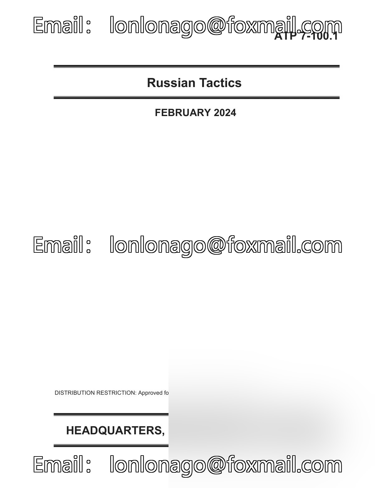
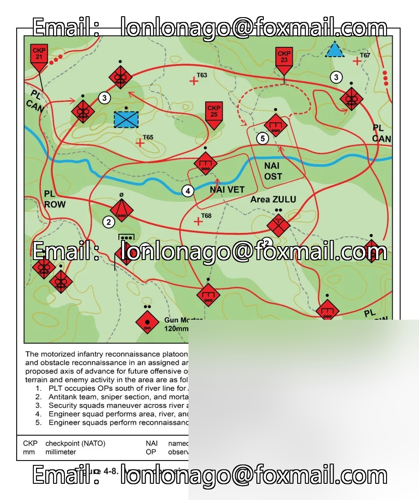
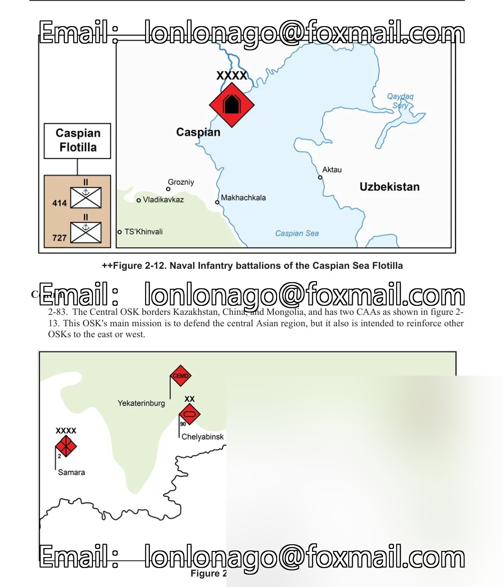
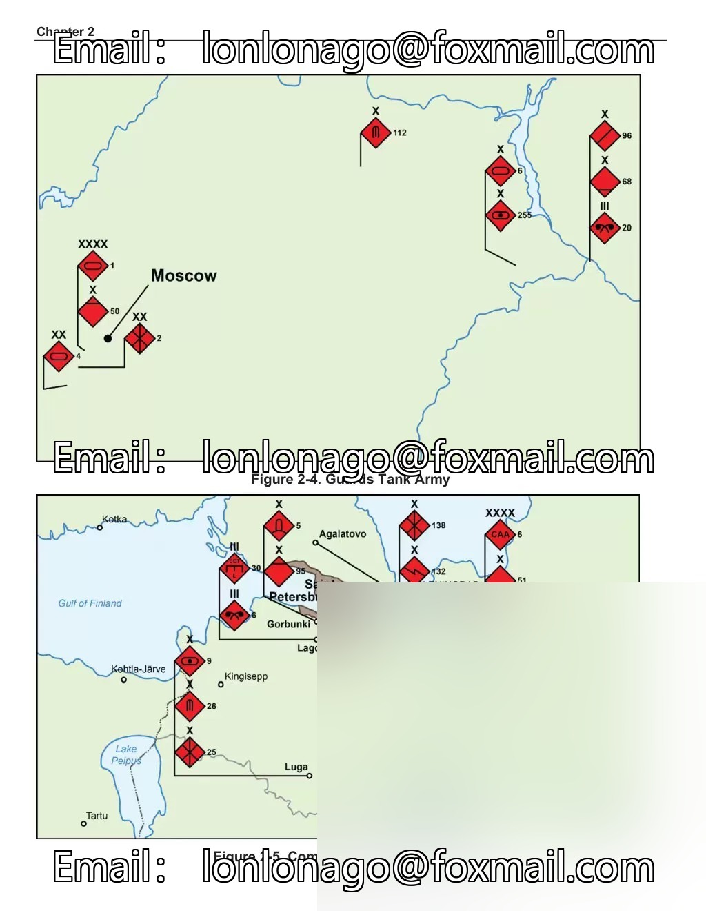

# American official documents, guiding documents for researching Russia's tactics!

## Body

Official documents of the US, guide files for studying Russia's tactics!
US Army ATP 7-100.1 "Russian Tactics" 2024 February edition, official public materials.
1. Analysis of the information system
1. Overview of military operations
- Tactical reconnaissance and surveillance actions
- Reconnaissance methods in river obstacle areas
- Parameter settings for cruise missile interception
2. Distribution of strategic areas
- Deployment of naval infantry battalions in the Caspian Sea
- Operational area of Central OSK (Central Administrative Squadron)
- Guards Tank Army (Guards Tank Army)
- Combined Arms Army - North (Combined Arms Army - North)
3. Example of tactical maps
- Unit action route map

- River obstacle zone reconnaissance tasks
- Important target identification annotation
4. Combat concept description
- Reconnaissance and surveillance task priority
- Battlefield situation awareness process
- Command and control key points
are replicable and cannot be refunded upon sale.

The document is an official US guidance on researching Russian tactics, covering tactical reconnaissance and surveillance, river obstacle reconnaissance, cruise missile interception parameters, strategic region distribution, tactical maps and operational concepts.

<!-- AI_ENRICHED -->

## Images

## Payment

Here is a pay link on Stripe ( https://buy.stripe.com/3cs8yP7sY87d0vu9AB ). Please contact me lonlonago@foxmail.com after funding $89, and I will send you a complete data files , thank you!

